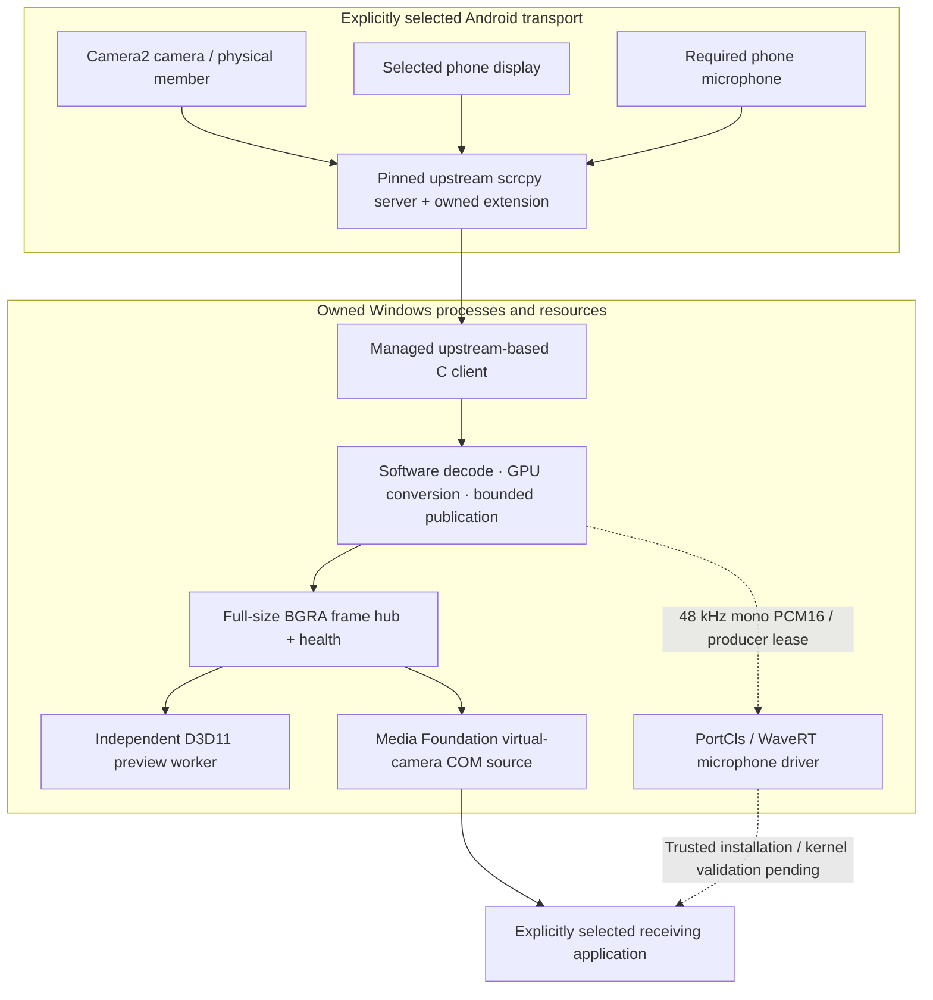

# WinDroid Capture · native output architecture

[← README](README.md) · [Build](docs/BUILDING.md) · [Rendering](docs/RENDERING.md) · [Validation](TEST_REPORT.md)

> [!NOTE]
> The two video consumers are independent. The application UI is never the captured source. The microphone path is implemented in source but its production installation and real receiving-input validation remain incomplete.

| Boundary | Ownership / invariant |
| --- | --- |
| ADB | Same explicitly selected executable for discovery and capture; shared server is preserved |
| Session | One producer, unique frame mapping/generation, bounded reconnect to the same selected device |
| Preview | Independent window visibility, rendering resources and scaling choice |
| Windows camera | Own CLSID and current-user registration; explicit stopped image on Stop/loss |
| Microphone | Own driver/producer lease; no playback, cable or unrelated desktop-audio path |
| Persistence | Local DPAPI profiles; no auto-start, account, telemetry or recording |

## Video path

Selected ADB transport → upstream scrcpy Android camera **or display** server → managed private upstream-based C client → bounded local packet export → user-mode FFmpeg software decoder → D3D11 YUV-plane conversion and BGRA readback → full-size BGRA frame hub.

A common publication stage applies to both source modes. Minimum latency publishes immediately. Smooth priority maps relative source PTS to QPC deadlines and buffers one requested frame interval using a two-entry queue. Overflow discards the oldest pending image and reports it. Large timing discontinuities, static-screen pauses and reconfiguration resynchronize without a growing backlog. Stop discards pending images before resource teardown. Decode/publication threads request MMCSS Capture scheduling; preview requests Playback. Unavailable tasks retain normal scheduling, without global timer, power or system-setting changes.

Two independent consumers:

- A renderer worker wakes on the session's advisory frame-ready event, waits for DXGI queue capacity before copying the newest stable frame, then uploads to the C manager's integrated Direct3D 11 preview. A one-frame waitable swap chain presents with SyncInterval 1. Health polling does not pace video. Copy contention retains a healthy image; stop/stale state invalidates it. Content/size/filter changes coalesce without fixed 16 ms video polling.
- The UI hides the flip-model canvas while a stopped, hidden or unavailable placeholder owns the preview rectangle, preventing the compositor from retaining a last-frame image over GDI. Showing the canvas requests one fresh renderer update; it does not trigger repeated copies on status polling.
- A Media Foundation source DLL pulls full frames through a secured local pipe and supplies NV12/RGB32 as Android Webcam Camera (Windows Virtual Camera).

Camera samples are paced on monotonic QPC deadlines using a high-resolution waitable timer, with immediate shutdown cancellation and bounded recovery after missed deadlines. No process-wide timer-resolution setting or spin loop is used. Media Foundation sample timestamps remain in its clock domain. The separate local receiver also wakes on coalesced frame messages and releases its sample lock before GPU conversion/presentation; its 50 ms UI timer updates only the footer and microphone meter.

MFCreateVirtualCamera uses a stable source CLSID, CurrentUser access and System lifetime. The camera remains enumerable between manager sessions; stopped receivers get an explicit stopped image. COM registration is machine-wide so Frame Server can load the DLL; camera registration belongs to the current user.

The UI is never captured. Covering/minimizing/hiding its preview does not alter output. There is no visible scrcpy window, OBS scene or desktop-capture fallback.

## Physical camera members and known-device profiles

The Pixel 10 Pro XL C profile opts into extended Camera2 enumeration from a separately built, upstream-based Android server. The extension enumerates logical-parent/physical-member relationships and binds the existing encoder OutputConfiguration to a selected member using setPhysicalCameraId. Identities use the AWM-specific awm-physical:<parent>:<member> form in the existing camera-id field; the scrcpy protocol is unchanged. Startup verifies membership, refuses high-speed/zoom combinations outside the implemented direct path and reports physical-result metadata. No logical-camera fallback is allowed for a failed direct selection.

The profile names the Pixel's known focal families from reported metadata and distinguishes smaller-sensor crop members; it never hard-codes a physical ID map. Unknown devices keep public upstream discovery. Per-device camera ID persistence is unchanged. A child-only server override applies to scrcpy-awm.exe when its sibling scrcpy-server-awm exists; ordinary scrcpy and the user's distribution retain their environment/files. The full extension/build/source hash manifest is packaged. See docs/PIXEL_CAMERAS.md.

## Audio path

Phone microphone → scrcpy explicit required mic source/raw PCM → user-mode host downmix to 48 kHz mono PCM16 → own IOCTL producer → own WaveRT capture buffer → Windows audio engine → receiving application.

No playback endpoint, speakers, cable, default-device change or desktop-audio capture is involved.

The PortCls/WaveRT C driver validates begin/write/reset/query sizes and formats and uses a per-file-object/generation producer lease. Producer close, timeout and underrun emit silence. Receiving phone PCM does not prove a Windows microphone.

**Driver not installed:** the unsigned binary/catalog cannot establish the endpoint. Installation, endpoint presence, PCM arrival, receiver samples, phone-specific sound and synchronization are separate gates.

## Ownership

A worker owns discovery/capability subprocesses, session transactions and bounded polling. Windows argument arrays/quoting, selected ADB environment and owned jobs are used. UI snapshots have a short lock. Stop cancels operations and invalidates earlier queued Starts.

Only one producer is allowed. Each session receives a unique GUID frame mapping and an ownership guard. Old readers cannot keep a stopped generation live or block the next Start. Frame readers use double buffers, sequence and video-epoch validation. Camera pipe ACLs allow owning user, SYSTEM and LocalService; remote clients are rejected. Consumers have bounded I/O and separate scaling resources.

The exporter sends ordered 500 ms heartbeats separately from content updates, with a three-second health deadline. A healthy static screen may reuse its last valid frame; camera content has an additional one-second freshness deadline. A camera consumer can request timed repeated samples without inventing new Android frames. Diagnostics reports content age and repeated samples. Stop invalidates the hub immediately, before owned subprocess teardown.

Display session/configuration events advance the video epoch, flush/reconfigure the decoder and wait for valid frames at the new dimensions. Reconfiguration temporarily emits a stopped/reconfiguring image. Windows camera output dimensions remain stable while phone orientation changes. Export and frame-hub protocol versions are 3; the installed camera RPC remains compatible version 2.

Opt-in reconnect targets the same serial/transport with at most three retries and stops on Stop. Shared ADB is never automatically killed/restarted. Android authorization cannot be bypassed.

## Image and clock semantics

Requested/declarative modes, observed captured dimensions, preferred software-camera format, camera sample requests and receiver negotiation are distinct. Fit preserves the source with bars; Crop to fill removes edges. Clockwise output rotation precedes horizontal mirroring. Screen orientation Follow/Lock belongs to scrcpy capture and is separate from these output transforms. Output resizing operates on full decoded frames through the selected D3D11 resampler; exact-size output copies pixels. Preview resizing is separate.

8-bit SDR formats have explicit RGB/full versus NV12/limited range. Unsupported decoded formats fail. No HDR guarantee is made.

Phone timestamps are transported, but kernel capture clock and camera pacing need sustained physical synchronization testing; there is no measured lip-sync guarantee.

Opt-in numeric trace files correlate anonymous session/frame identities across the host and integrated preview. FFmpeg COPY_OPAQUE propagates each compressed packet's PC arrival timestamp to its decoded frame. Absolute Android PTS is never subtracted from PC QPC. The receiver's callbacks lack a source frame ID and establish cadence only. These traces contain no images, audio, device identifiers or credentials; buffering and five-second flushes avoid one disk write per frame. Graphs and measurement limits are documented in docs/PERFORMANCE.md.

## UI and persistence

Four Win32 pages share native control input/accessibility and custom buffered painting. System/Light/Dark appearance uses documented APIs and respects high-contrast colors. GDI panes and native alternate repaint paths are buffered separately from the D3D canvas. Unchanged control selections, checks, enabled states and visibility are not reset every 100 ms. Layout scales rectangle edges together so fractional DPI rounding cannot push borders outside their parent. Resize/layout invalidates the painted backgrounds, including empty space, to remove obsolete divider/box lines; status polling does not invalidate whole panels.

Open native dropdowns own their provisional hover/keyboard highlight; snapshot refreshes defer selection updates until the list closes. Output settings save on CBN_SELENDOK, or CBN_SELCHANGE for keyboard changes in a closed list. Duplicate acceptance notifications are coalesced. Polling never interprets an Appearance highlight as user acceptance, so canceled keyboard browsing cannot change the saved theme.

Source Settings has a boxed header and independent scrolling, extending down the right column alongside the left preview's Windows-input rows. Hide preview shares the preview header. Compact status and operation messages sit at the top right beside navigation, allowing a smaller bottom capture-action band. Detailed source/output information is in Diagnostics and documentation. Source fields keep fixed coordinates inside one content panel; scrolling translates that single panel behind a clipped viewport. Windows' old-client-pixel copying and synchronous erase synchronization are disabled on repositioning. The scrollbar keeps native range/accessibility information but owns input/paint to avoid the native modal drag drawing over it. Its original gray checker focus blink is rendered inside the thumb's buffer, using the user's Windows caret blink cadence; no OS caret overlays the composited pane. Range/mouse changes queue paint after the deferred panel movement instead of forcing a synchronous intermediate frame. Combo owner draw also fills its supplied selection DC immediately. An opt-in AWM_UI_LAYOUT_TRACE records geometry-only clipping/overlap evidence from the app's own controls.

The main tab face and parent navigation divider share one 42-DIP bottom edge. Main and Settings tab strips draw a continuous outer left edge from their control bounds. Setup actions sit inside labeled rectangular panels; the panel outlines use the pixel rectangles computed by layout, avoiding a separate painting/layout position calculation. Resize invalidation discards obsolete background divider pixels after child positions have been applied.

When the focused scrollbar is hovered, its gray checker focus phase alternates with the blue hover fill. Pattern inversion only uses the gray base, preventing an inverted blue fill from producing a red/orange phase. The existing Windows blink cadence and buffered drawing remain unchanged. The whole-scrollbar dotted rectangle is omitted; thumb animation still identifies focus.

The top-right status STATIC retains a complete accessible text summary and paints four independently colored dots and values in one buffered pass. Semantic changes invalidate only that control. Colors have distinct light/dark palettes and use system text in high contrast. Typed manager snapshots distinguish output enumeration attempted, live source health and actual microphone forwarding; Stop, process failure and device loss clear the live flags. Input availability and receiver verification remain distinct.

DPAPI settings v6 store separate per-device camera/screen profiles, last source, dependency paths, preferred output, scaling choices, appearance and presentation pacing. Earlier supported settings are backed up before migration; v5 defaults to Smooth priority. Malformed/future versions are rejected without replacement. Capture never auto-starts.

## Source map

- src/native/manager.c, command.c, capture_profile.c, settings.c: device/session/configuration.
- native/scrcpy: upstream sink adapter and Windows C compatibility.
- src/native/media_host.c, frame_hub.c: decoding, transports, transforms, health.
- src/native/preview.c, preview_worker.c, composition.c, scale_shader.h, color_shader.h: D3D11 conversion, preview/output composition and scaling.
- src/native/ui: Capture, Devices, Settings, Diagnostics, theme and layout.
- camera/source.c, control.c: C COM source and scoped installer.
- drivers/microphone: C kernel driver/package/installer.
- tests/native_receiver.c: independent explicit local receiver.
- camera/pacer.h: cancellable monotonic camera sample deadlines.
- src/native/timing.h, scripts/plot-timing.py: opt-in numeric measurements and graphs.

OBS/VB-CABLE code is archived and excluded from the normal build.
