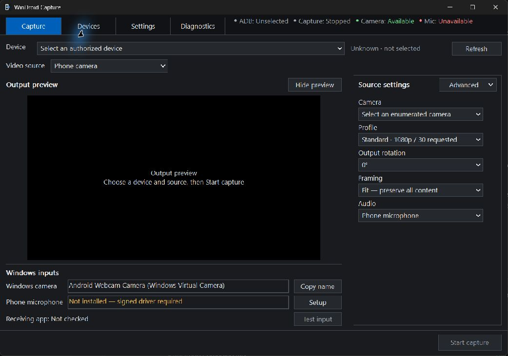
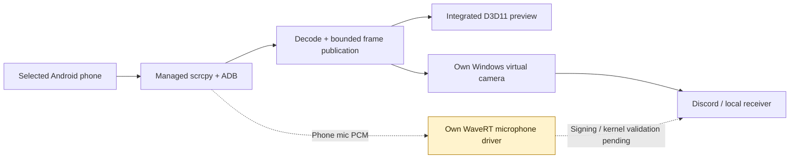

<div align="center">


# WinDroid Capture

**Your Android camera or screen, through a Windows virtual camera.**

A compact C desktop app with an integrated Direct3D 11 preview, explicit device selection,
and an output path that works independently of the preview window.


[Get started](docs/QUICKSTART.md) · [Build from source](docs/BUILDING.md) · [Controls](docs/CONTROLS.md) · [Test evidence](TEST_REPORT.md) · [Releases](https://github.com/wellivea1/WinDroidCapture/releases)

</div>

> [!IMPORTANT]
> **Video is usable; the phone microphone is unfinished.** Real Pixel camera video has appeared in the local Windows receiver and Discord's local Test Video. Screen capture works in the local receiver. Our microphone driver builds, but is unsigned, uninstalled and untested in the kernel. This development build does **not** yet deliver both webcam and phone microphone to Discord. Video micro-stutters and receiver-sharing limitations also remain.

<p align="center">
  
  <br>
  <sub>Actual Windows application. Capture is stopped; no phone or personal content is shown.</sub>
</p>

## A small control room for your phone

| Capture | Windows output | Rendering | Device management |
| --- | --- | --- | --- |
| Camera or selected phone display | App-owned Media Foundation virtual camera | Integrated D3D11 preview | USB and modern wireless-debugging pairing |
| Enumerated cameras, displays and encoders | Output continues with the preview hidden | EWA Lanczos, Lanczos 3 or bilinear | Distinct authorization, offline and unsupported states |
| Editable Standard, Detail and Motion profiles | Fit/crop, clockwise rotation and mirroring | Smooth-priority or minimum-latency pacing | Per-device camera/screen profiles, DPAPI storage |
| Pixel 10 Pro XL direct rear lens choices | Explicit stopped image on Stop/loss | System, light and dark appearance | Local diagnostics; no account, telemetry or recording |

The normal capture path has **no OBS or VB-CABLE dependency** and no separate scrcpy preview window. The Windows camera is registered once; the ordinary controller runs without elevation.

## Five steps to a local video test

1. Extract a [development release](https://github.com/wellivea1/WinDroidCapture/releases), or [build the source](docs/BUILDING.md). Install the matching official **scrcpy 5.0.1** distribution separately.
2. [Install/register the camera source](docs/QUICKSTART.md#2-install-the-windows-camera) and select the scrcpy/ADB paths in **Settings → Dependencies**.
3. Connect and authorize the phone. Choose **Phone camera** or **Phone screen**, then an enumerated source. Discovery alone does not start capture.
4. Choose **Audio: Off** for this unsigned-driver build, then press **Start capture**.
5. Open Discord **Settings → Voice & Video** and explicitly select the camera below. For an isolated test, close other camera consumers and use the app's **Test input** button.

| Discord setting | Exact Windows input | Current state |
| --- | --- | --- |
| **Camera** | `Android Webcam Camera (Windows Virtual Camera)` | Real video verified in Discord's local Test Video |
| **Input Device** | `Android Webcam Microphone` | Intended own endpoint; **unavailable until a trusted driver is installed** |

The product rename preserves installed input identities and encrypted settings. A PC microphone or cable is never substituted for the missing phone input. See the [quickstart](docs/QUICKSTART.md) for USB, wireless, installation and verification steps.

## Two output paths, one selected phone



The preview and Windows camera consume full decoded frames independently. Minimizing the app or hiding its preview does not stop output. Requested modes, reported capabilities, observed source dimensions and a receiving app's negotiated format are tracked separately. A higher nominal resolution is never proof of better image quality.

### Pixel 10 Pro XL: choose the lens directly

The known-device profile exposes rear **wide, ultrawide and telephoto** members, plus reported crop variants. A small extension to the pinned upstream Android server binds its encoder surface through Camera2's physical-output API. It keeps the scrcpy protocol and camera pipeline; it does not install a replacement camera app.

Lens names come from metadata. IDs are re-enumerated instead of guessed. On the tested Android 17 firmware, all three main rear members delivered real 1920×1080 frames; direct ultrawide and telephoto also reached the independent Windows receiver. These are delivery checks, not optical-quality or 4K/60 guarantees. [Camera bindings and evidence →](docs/PIXEL_CAMERAS.md)

<details>
<summary><strong>Rendering, smoothness and what our graphs actually measure</strong></summary>

**EWA Lanczos sharp** is the default in both scaling lists. **Preview scaling** applies immediately; **Pipeline scaling** applies at the next Start. Exact-size output bypasses resampling. These are independently written C/HLSL implementations informed by pinned mpv references.

**Smooth priority** is the default presentation policy. A bounded queue intentionally adds about one requested frame interval (approximately 33 ms at 30 FPS or 17 ms at 60 FPS) to absorb uneven arrivals. **Minimum latency** publishes on arrival. Neither reconstructs missing phone frames.


The real screen-motion trace contains 759 valid joined frames. It distinguishes phone PTS intervals, PC packet arrival, integrated-preview submissions and independent receiver callbacks. PC packet → Present return had a **44.10 ms median / 49.69 ms p95** in this buffered run. Those values exclude phone capture/encoding and display scanout; they are **not phone-to-display latency**. Residual micro-stutters remain.

[Read the measurements and repeat the procedure](docs/PERFORMANCE.md) · [Rendering implementation and mpv references](docs/RENDERING.md)

</details>

## Build and validate

With [the required tools and source packages](docs/BUILDING.md) installed, run in PowerShell 7:

```powershell
.\scripts\build.ps1
.\scripts\test.ps1 -SkipBuild
.\scripts\publish.ps1 -SkipBuild -SkipTests
```

Tests cover discovery, explicit multi-device selection, capabilities, safe arguments, Unicode paths, configuration, fake lifecycle races/cleanup, actual GPU components and the COM camera source. They are labeled by scope. The retained October 13 run includes a **shared-pacing timing failure**, so an entirely passing suite is not claimed. No CI badge substitutes for physical validation.

The optional microphone-driver build is `.\scripts\build-driver.ps1`; building it does not sign it or create a usable input. [Current test report and blockers →](TEST_REPORT.md)

## Documentation map

| I want to… | Read |
| --- | --- |
| Set up the phone, camera and Discord | [Quickstart](docs/QUICKSTART.md) |
| Understand settings and profile behavior | [Controls](docs/CONTROLS.md) |
| Build the C app, Android extension or driver | [Building](docs/BUILDING.md) |
| Resolve missing inputs, startup failures or stutter | [Troubleshooting](docs/TROUBLESHOOTING.md) |
| Inspect process boundaries, frame flow and ownership | [Architecture](ARCHITECTURE.md) |
| Check direct Pixel camera selection | [Pixel cameras](docs/PIXEL_CAMERAS.md) |
| Reproduce frame-time graphs | [Performance](docs/PERFORMANCE.md) |
| Separate automated checks from actual phone results | [Test report](TEST_REPORT.md) |
| Review the public-source boundary | [Publication review](docs/PUBLISHING.md) |
| Inspect dependency versions and redistribution terms | [Third-party notices](THIRD_PARTY_NOTICES.md) |

## Brand and project history

The refined **Phone Lens** mark is the production Windows icon. Its complete ring sits within the phone screen. [Production SVG](src/assets/windroid-capture.svg) · [Ten-size Windows ICO](src/assets/windroid-capture.ico) · [Editable six-concept SVG sheet](docs/design/windroid-capture-logo-concepts-v2.svg)

Normal builds use committed artwork. The optional [branding script](scripts/build-branding.mjs) renders each size from the SVG at 4× resolution and downsamples once with Lanczos 3.

<details>
<summary>Earlier names, design concepts and the original bridge</summary>

The project began as Android Webcam Manager with an OBS/VB-CABLE bridge. That code and its [older documentation](docs/history/README-0.2.0.md) remain for history, excluded from the normal build. The old storage/install names and Windows input identities are retained for compatibility. Design boards under `docs/design` are illustrative concepts, clearly separate from the actual screenshot above and hardware evidence. Original raw local evidence and backup archives are not published.

</details>

Dependency licenses and notices are included under [licenses](licenses) and in [THIRD_PARTY_NOTICES.md](THIRD_PARTY_NOTICES.md). No project-wide license has been selected for the remaining original project material.
