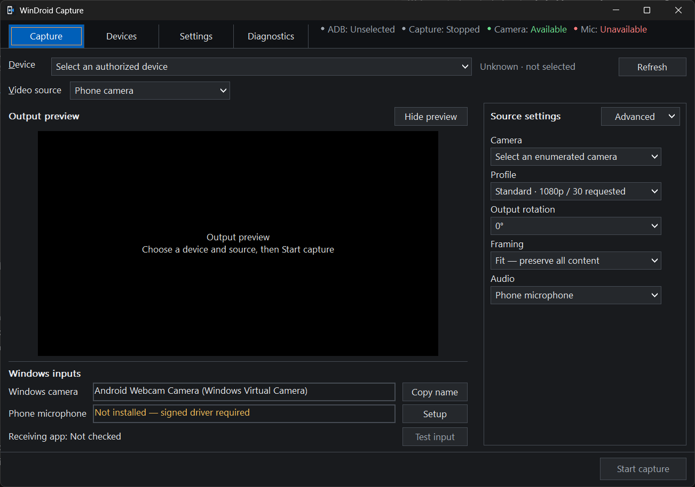

# WinDroid Capture

**Turn your Android camera or screen into a Windows webcam.**

Choose your phone, start capture, and use it in Discord. The preview is built in.

**[Download for Windows](https://github.com/wellivea1/WinDroidCapture/releases/tag/v0.3.0-dev.1)** · **[Setup guide](docs/QUICKSTART.md)** · [Get help](docs/TROUBLESHOOTING.md)

> [!IMPORTANT]
> This early release supports **video only**. Phone microphone support is still in development, and video may occasionally stutter. [Current limitations](docs/TROUBLESHOOTING.md).

  
   
  Actual application, with capture stopped and no phone selected. Click to view the full-size screenshot.

## What you can do

- Use your phone's **camera or screen** as a Windows camera input.
- Choose a camera, including direct rear-lens options on the **Pixel 10 Pro XL**.
- Adjust resolution, frame rate, rotation and mirroring.
- Hide the preview while video continues, and choose a light or dark interface.

No OBS or virtual audio cable is needed. Capture stays local, with no account, telemetry or automatic recording.

## Get started

1. **Download and set up the app.** Windows 11 and the matching phone-connection tools are required; the [setup guide](docs/QUICKSTART.md) walks through both.
2. **Connect your phone**, unlock it and allow USB debugging. Select the phone in the app.
3. **Choose Phone camera or Phone screen**, set **Audio: Off**, then press **Start capture**.
4. In **Discord → Settings → Voice & Video → Camera**, select:

   **Android Webcam Camera (Windows Virtual Camera)**

Use Discord's **Test Video** to check the picture. To change phones or sources, press **Stop** first. [Camera settings explained](docs/CONTROLS.md) · [Wireless setup](docs/QUICKSTART.md#wireless-connection-optional)

<strong>More help and settings</strong>

- [Setup and local video testing](docs/QUICKSTART.md)
- [Camera, screen and appearance controls](docs/CONTROLS.md)
- [Missing devices, startup problems and stutter](docs/TROUBLESHOOTING.md)
- [Pixel 10 Pro XL camera choices](docs/PIXEL_CAMERAS.md)

<strong>For developers: source, performance and test results</strong>

The Windows app is written in C, with an integrated Direct3D 11 renderer and an app-owned virtual camera. Technical details are kept in the guides below.

- [Build from source](docs/BUILDING.md)
- [Architecture and output paths](ARCHITECTURE.md)
- [Rendering, scaling and mpv references](docs/RENDERING.md)
- [Measured frame timing and graphs](docs/PERFORMANCE.md)
- [Automated checks, physical results and remaining blockers](TEST_REPORT.md)
- [Public-source review](docs/PUBLISHING.md)
- [Dependency versions and notices](THIRD_PARTY_NOTICES.md)
- [Editable Phone Lens artwork](src/assets/windroid-capture.svg) and [logo concept sheet](docs/design/windroid-capture-logo-concepts-v2.svg)

No project-wide license has been selected. Existing dependency licenses are included in the [notices](THIRD_PARTY_NOTICES.md).

