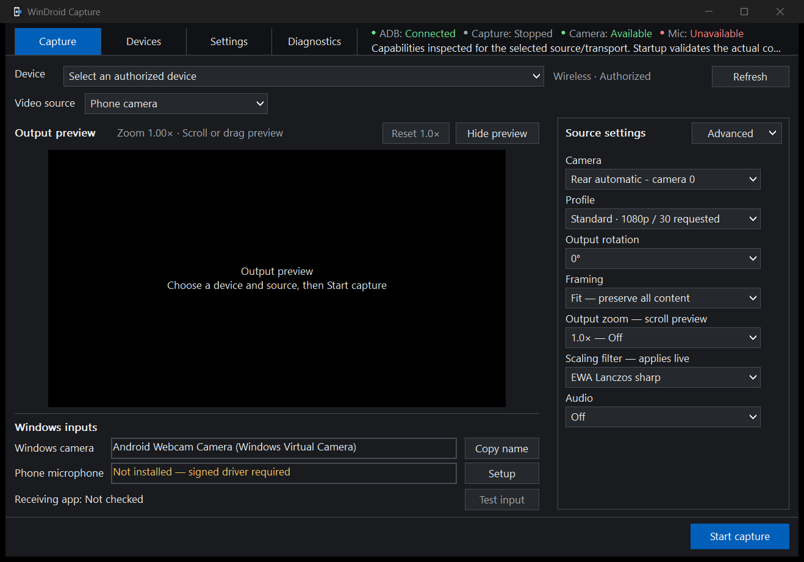

# WinDroid Capture

**Turn your Android camera or screen into a Windows webcam.**

Choose your phone, start capture, and use it in Discord. The preview is built in.

**[Download for Windows](https://github.com/wellivea1/WinDroidCapture/releases/tag/v0.3.0-dev.3)** · **[All releases](https://github.com/wellivea1/WinDroidCapture/releases)** · **[Setup guide](docs/QUICKSTART.md)** · [Get help](docs/TROUBLESHOOTING.md)

> [!IMPORTANT]
> This early release supports **video only** (**Audio** defaults to **Off** while the phone microphone kernel driver remains unsigned and in development). See [current limitations](docs/TROUBLESHOOTING.md).

  
   
  Actual application, with capture stopped. Click to view the full-size screenshot.

## What you can do

- **Camera or screen as a Windows webcam:** Expose your Android camera or display as `Android Webcam Camera (Windows Virtual Camera)` for Discord, OBS, or other Windows camera apps, including direct rear-lens choices on the **Pixel 10 Pro XL**.
- **Interactive live zoom & pan (`1.0×`–`8.0×`):** Scroll or drag directly over the video preview to zoom toward the cursor and pan (`double-click` or **Reset 1.0×** to reset), applied live to both the preview and virtual camera output.
- **4 live GPU scaling filters:** Switch between *EWA Lanczos sharp*, *Lanczos 3*, *Bilinear*, and *Nearest — pixel crisp* on the fly from **Capture** or **Settings**.
- **Low-latency GPU pipeline:** D3D11VA hardware video decoding (with automatic CPU fallback), GPU YUV/rotate/mirror/NV12 conversion, cross-session shared-memory camera transport, zero-copy video pacing queue, and triple-buffered low-latency DXGI flip-model preview.
- **Live controls & smoother setup:** Rotation, mirroring, framing, zoom/pan, and scaling apply live without stopping capture; changing source, camera, or resolution restarts automatically. Includes event-driven ADB detection, wireless mDNS discovery with chained pair/connect, opt-in USB and wireless reconnect, and one-click UAC camera installation (**Settings → Output → Install camera source**).
- **Private & local:** No OBS or virtual audio cable required, no account, telemetry, or automatic recording; hide the preview while video continues and switch between System, Light, or Dark themes.

## Get started

1. **Download and set up the app.** Windows 11 x64 and the matching official `scrcpy 5.0.1` runtime are required; the [setup guide](docs/QUICKSTART.md) walks through setup (including one-click **Install camera source** and auto-discovered `scripts\run.ps1`).
2. **Connect your phone** over USB (with USB debugging allowed) or wireless debugging (**Devices** tab). When a single authorized phone is connected, it is pre-selected automatically—capture never starts on its own.
3. **Choose Phone camera or Phone screen** (**Audio** defaults to **Off**), then press **Start capture**.
4. In **Discord → Settings → Voice & Video → Camera**, select:

   **Android Webcam Camera (Windows Virtual Camera)**

Use Discord's **Test Video** to check the picture. Scroll or drag over the preview to zoom and pan; double-click to reset. [Camera settings explained](docs/CONTROLS.md) · [Wireless setup](docs/QUICKSTART.md#wireless-connection-optional)

<strong>More help and settings</strong>

- [Setup and local video testing](docs/QUICKSTART.md)
- [Camera, screen and appearance controls](docs/CONTROLS.md)
- [Missing devices, startup problems and stutter](docs/TROUBLESHOOTING.md)
- [Pixel 10 Pro XL camera choices](docs/PIXEL_CAMERAS.md)

<strong>For developers: source, performance and test results</strong>

The Windows app is written in C, with an integrated Direct3D 11 renderer and an app-owned virtual camera. Technical details are kept in the guides below.

- [Build from source](docs/BUILDING.md)
- [Architecture and output paths](ARCHITECTURE.md)
- [Rendering, scaling and mpv references](docs/RENDERING.md)
- [Measured frame timing and graphs](docs/PERFORMANCE.md)
- [Automated checks, physical results and remaining blockers](TEST_REPORT.md)
- [Public-source review](docs/PUBLISHING.md)
- [Dependency versions and notices](THIRD_PARTY_NOTICES.md)
- [Editable Phone Lens artwork](src/assets/windroid-capture.svg) and [logo concept sheet](docs/design/windroid-capture-logo-concepts-v2.svg)

No project-wide license has been selected. Existing dependency licenses are included in the [notices](THIRD_PARTY_NOTICES.md).

