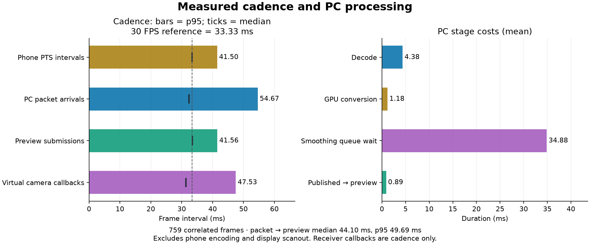

# Latency and jitter measurements

The numeric timing mode measures real PC stages and plots their variation. It does not save phone pictures/audio, transmit data, join calls or substitute a physical PC camera/microphone. It is opt-in and does not run during normal capture.

## Reproduce a graph

Close the manager. Install matplotlib and numpy in a developer Python environment if needed (`python -m pip install matplotlib numpy`), then:

```powershell
.\scripts\measure-timing.ps1 -ScrcpyFolder 'C:\path\scrcpy-win64-v5.0.1' -ReferenceFPS 30
```

In the manager explicitly select the phone and source, start capture, leave the integrated preview visible and perform motion for about 30 seconds. Stop and close the application to finish/flush the trace and generate graphs. Use a fresh directory each run. Screen capture is variable rate: a long gap on an unchanged screen is not automatically a dropped frame. Use repeated neutral Settings-page scrolling for the motion test. The FPS argument draws a reference line; it does not assert the phone delivers that frame rate.

The launcher writes capture.csv, preview.csv, the all-packet companion capture.csv.packets.csv and two aggregate text files to a new local evidence directory. The plotting tool creates timing-overview.png, timing-over-time.png, timing-distributions.png, timing-summary.json and timing-derived.csv. Derived data uses relative time and omits session identities/absolute QPC values. Raw traces remain local and are not included in published packages.

For a separate Windows-camera cadence measurement, while the manager captures, run:

```powershell
$env:AWM_RECEIVER_TRACE_CSV='C:\new-test-folder\receiver.csv'
.\build-native\awm-native-receiver.exe --video-only --duration 40 --width 1280 --height 720 --fps 30
Remove-Item Env:AWM_RECEIVER_TRACE_CSV
```

The receiver explicitly enumerates **Android Webcam Camera (Windows Virtual Camera)**. Video-only mode intentionally does not test a microphone. Close other receiving apps' camera tests first; concurrent use previously failed on this desktop. To add its callback intervals to the same graph:

```powershell
python .\scripts\plot-timing.py --capture 'C:\test\capture.csv' --preview 'C:\test\preview.csv' --receiver 'C:\test\receiver.csv' --out 'C:\test\graphs' --fps 30
```

An optional `--motion-window motion-window.json` selects a documented interval with numeric PC `start_ms` and `end_ms`. We used QPC stamps around targeted alternating Settings swipes on the explicitly selected USB transport. The motion plots exclude the first two seconds of that interval; full-run plots preserve static gaps. No unexplained tail trimming or mock success is used.

## Reading the graph

- **Phone PTS intervals** are differences between phone presentation timestamps. They show source cadence, without comparing incompatible clock origins.
- **PC packet intervals** are arrivals of complete compressed video packets at the media host.
- **Preview intervals** are successful submissions of distinct source frames to the integrated D3D11 preview. Resize/filter redraws of the same source frame are counted separately.
- **Virtual-camera callback intervals** show what the independent Media Foundation receiver receives. Repeated images can be valid timed camera samples, so cadence alone does not establish new content.
- **PC delay** matches anonymous session plus frame number and measures packet arrival to return from preview Present. FFmpeg propagates packet timing through decoding using COPY_OPAQUE. Missing or inconsistent timestamps are rejected, rather than replaced with guesses.
- **Stage costs** separate decode, GPU conversion, smoothing-queue wait and preview rendering/Present. The all-packet companion preserves packet cadence even if the bounded queue drops a pending image. Per-frame writes are buffered and flushed every five seconds.

At 30 FPS an even interval is 33.33 ms; at 60 FPS it is 16.67 ms. A low median delay with large interval spikes can still feel jerky. Percentiles, maxima, sample counts and the whole measured tail accompany the plots. All measured windows are identified in TEST_REPORT.md.

## Limits and full end-to-end measurement

These PC measurements exclude phone sensor/readout, phone rendering/encoding, upstream transport before the host timestamp, display/compositor buffering and monitor scanout. Return from Present is not proof a frame has appeared on the screen. Callback timing is not Discord display timing, and our camera API currently does not expose a source frame identity for a source-to-receiver latency join. No such latency number is generated.

For optical end-to-end testing, show an advancing frame counter/test pattern on the phone and inspect the phone and receiving preview together with a sufficiently fast external camera. Frame-by-frame differences then measure actual displayed delay and repeated/uneven frames. Alternatively, aim the phone camera at a flashing counter and observe source/receiver together. This requires an explicit user action to make a recording, and has **NOT RUN** here. No invented sensor/display or A/V latency is reported. The own microphone remains unsigned/uninstalled, so microphone latency and native clap synchronization are **NOT RUN**.

## Why mpv informed the changes

The official pinned mpv [video output queue](https://github.com/mpv-player/mpv/blob/88eb9f2e73945d8bc9c133a2f67babaa9af34680/video/out/vo.c), [D3D11 context](https://github.com/mpv-player/mpv/blob/88eb9f2e73945d8bc9c133a2f67babaa9af34680/video/out/d3d11/context.c) and [plane upload implementation](https://github.com/mpv-player/mpv/blob/88eb9f2e73945d8bc9c133a2f67babaa9af34680/video/out/d3d11/ra_d3d11.c) informed event wakeups, bounded queues, synchronized presentation and discard uploads. These are independently implemented C/HLSL paths. The high-resolution camera timer and waitable DXGI queue follow documented Windows APIs on the verified Windows 11 build 26200. EWA Lanczos remains the existing default.

A bounded PTS-aware publication buffer is implemented with Smooth priority as the default and Minimum latency as a selectable alternative, shared by camera and screen. Decode/publication request MMCSS Capture scheduling, and preview requests Playback, following mpv's default [Windows renderer choice](https://github.com/mpv-player/mpv/blob/88eb9f2e73945d8bc9c133a2f67babaa9af34680/video/out/w32_common.c). These per-thread requests add no buffer or global system changes. Their benefits must be measured on each desktop. GPU decoding/direct surface transport and display presentation statistics remain future work.

## Results on this desktop

The final physical screen run used the Pixel's neutral Settings page, 22 alternating targeted swipes, the 30 FPS Balanced profile, observed 862×1920 source frames and a separate 1280×720/30 Windows-camera receiver. The motion window excludes its first two seconds. There are 759 valid packet/frame joins and no inconsistent joins. This run predates the final gentle clock-offset refinement; phone unavailability interrupted that screen retest. The exact screen refinement remains **NOT RUN physically**. The Pixel returned on October 13 and direct-camera member delivery was retested through the current Smooth-priority pipeline; those separate source/receiver results are in [TEST_REPORT.md](../TEST_REPORT.md), without a controlled Discord smoothness claim.



| Motion-window measurement | Median | 95th percentile | Maximum |
| --- | ---: | ---: | ---: |
| Phone PTS interval | 33.39 ms | 41.50 ms | 83.69 ms |
| Complete packet arrival interval | 32.40 ms | 54.67 ms | 89.42 ms |
| Integrated preview submission interval | 33.48 ms | 41.56 ms | 82.30 ms |
| Windows-camera receiver callback interval | 31.41 ms | 47.53 ms | 51.52 ms |
| PC packet → preview Present return | 44.10 ms | 49.69 ms | 52.82 ms |

The same trace shows the preview's long-interval tail closer to phone PTS than to raw packet arrivals. The buffer absorbs some arrival variation; it does not generate missing intermediate phone images. Queue wait averaged **34.88 ms** (median 37.61 ms), GPU conversion averaged **1.18 ms**, and publication-to-preview submission averaged **0.89 ms**. Five queue drops occurred before the selected motion window; its cumulative counter did not increase during that window. No late publications were reported. The receiver obtained 1,197 timed samples / 809 changing samples over its full 40-second run, with HRESULT 0 and video-only exit code 0. Repeated samples are not counted as new phone content.

An earlier unbuffered motion run measured 6.97 ms median / 8.13 ms p95 PC delay, 48.72 ms p95 preview intervals and 47.90 ms p95 receiver intervals. These are separate observational runs, not a controlled sensor/display latency comparison. The intermediate high-resolution-camera-timer run still measured 47.26 ms p95 receiver intervals and used a larger manager viewport, so it did not establish a material receiver-jitter improvement. The latest Smooth-priority run still has uneven source and receiver cadence; no final Discord subjective-smoothness pass is claimed.

The final synthetic queue check reduced injected packet-interval standard deviation from **11.41 to 0.25 ms at 30 FPS** and **5.65 to 0.20 ms at 60 FPS**, with 90 published frames per case and zero queue drops/late publications. The final D3D11 preview check retained **135/135** warm frame updates at 30 FPS and **264/270** at 60 FPS under current desktop load. These are synthetic regression checks, not physical-device or display-scanout results. The latest clock-offset code removes accidental startup delay gradually (at most 0.25 ms per new frame), while preserving the bounded queue. Hardware benefit is unverified.

Full plots, distributions and anonymized derived values are under [screen-smooth-final](performance/20261012/screen-smooth-final/timing-summary.json). The repeatable script keeps source/packet/preview/receiver boundaries separate and exposes the smoothing cost instead of presenting the buffer as a latency-free improvement. EWA Lanczos remains the selected scaler; actual GPU conversion, event wakeups, discard uploads and per-thread multimedia scheduling reduce overhead without intentionally adding a frame buffer.
