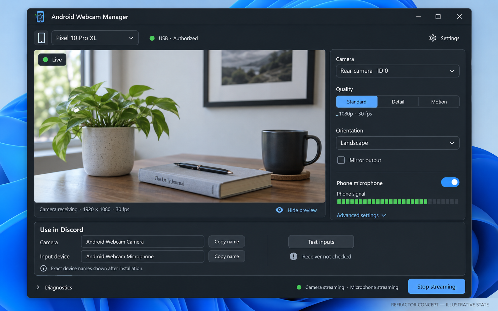
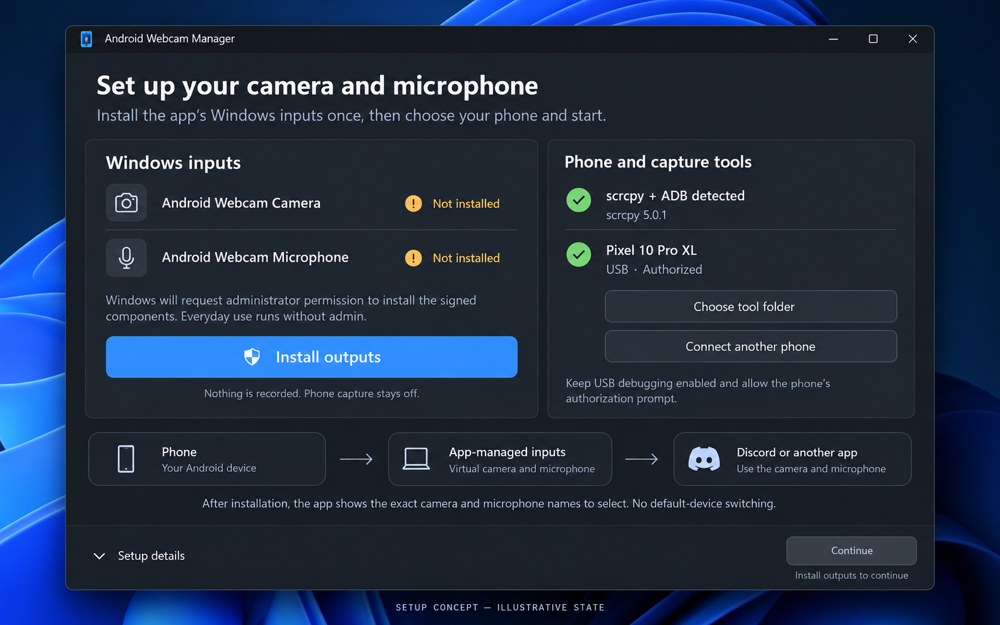

# WinDroid Capture refactor plan

Proposed implementation plan, 12 October 2026. This replaces the output architecture for the next release; the existing executable and its physical test results still describe the current OBS and VB-CABLE implementation.

The next release should own its Windows camera and microphone inputs, use an integrated preview, and keep streaming when the preview is hidden or the manager is minimized. Normal use should be: select an authorized phone, choose a camera and quality profile, press **Start streaming**, and select the app's two inputs in Discord. OBS, a separate scrcpy window, Windows Volume Mixer, and VB-CABLE leave the normal setup path.

## Verified starting point

The workspace contains a C17 Win32 application, asynchronous session engine, selected-device ADB discovery, scrcpy subprocess management, camera capability parsing, DPAPI settings, OBS control, audio endpoint enumeration, and local receiver tests. No AGENTS.md was found in the workspace or the checked parent directories. The workspace has no Git repository.

This PC runs **Windows 11 Pro x64, version 10.0.26200, build 26200**. The selected scrcpy binary is **5.0.1**, matching the [current official release](https://github.com/Genymobile/scrcpy/releases/latest) checked for this plan. SDK directories 26100 and 28000 are present. The 28000 kit contains kernel headers, PortCls/KS libraries, WDK build files, Inf2Cat, and SignTool. Inf2Cat's help command runs; that establishes tool availability, not a successful driver build. Use the installed SDK/WDK pair with matching build numbers and verify the driver platform toolset in the first build milestone. Microsoft's [WDK installation guidance](https://learn.microsoft.com/en-us/windows-hardware/drivers/download-the-wdk) requires a matching SDK/WDK build pair.

The current code's central dependencies are concrete:

- src/engine.c stores a capture HWND, checks its native size, and starts OBS only after a second Start action and an OBS approval.
- src/core.c builds a borderless scrcpy window and applies display orientation to that window.
- src/main.c exposes five tabs, separate preview/setup/start actions, manual probing and profile saving, and a large permanently visible status area.
- The main window has a minimum size of 1190 by 937 logical units and no responsive WM_SIZE layout.
- src/audio.c observes scrcpy playback on a cable. It does not receive microphone PCM directly.

Reuse device identity, parsing, selected ADB handling, safe argument arrays, cancellation epochs, bounded reconnection, settings protection, and existing tests. Replace the window-dependent output machinery.

## Target capture and output paths

~~~mermaid
flowchart LR
    P[Selected phone camera and microphone] --> S[Headless upstream-based scrcpy subprocess]
    S --> E[Versioned local video and audio export]
    E --> H[C media host and shared clock]
    H --> C[App-owned Windows software virtual camera]
    H --> A[App-owned virtual microphone driver]
    H --> V[Optional integrated preview]
    C --> R[Discord or another explicit receiver]
    A --> R
~~~

The preview is a consumer of decoded frames. The virtual camera consumes full-resolution frames independently. Making the preview smaller, covering the manager, hiding the preview, or minimizing the manager must not change or suspend outgoing video or microphone samples.

Keep the controller, media host, camera component, and microphone driver written in **C**. Use Windows COM interfaces through their C declarations and explicit vtables. Microsoft's samples are architectural references; importing a C++ driver implementation would change the language requirement.

### Headless scrcpy capture

Keep ADB and the upstream Android scrcpy server. Keep one explicitly selected transport and one capture session. Do not write a replacement Android camera app or duplicate the scrcpy wire protocol.

Stock scrcpy 5.0.1 documents --no-playback, --no-window, and recording both encoded streams. Its recorder explicitly opens a file: URL, so arbitrary stdout, pipe: URLs, or a fabricated Windows frame-export flag cannot be assumed to work. An in-memory Windows named-pipe experiment is possible, but opening a pipe alone would not prove acceptable buffering, timestamps, cancellation, or live delivery. See the tagged [recording documentation](https://github.com/Genymobile/scrcpy/blob/v5.0.1/doc/recording.md) and [recorder implementation](https://github.com/Genymobile/scrcpy/blob/v5.0.1/app/src/recorder.c).

**Recommended production design:** budget a small, isolated C export adapter in an upstream-based scrcpy client build. Connect it to upstream's existing [packet sink interface](https://github.com/Genymobile/scrcpy/blob/v5.0.1/app/src/trait/packet_sink.h). Export codec parameters, encoded packets, source timestamps, stream changes, and end/error events over a local, versioned protocol. Decode once in the media host using FFmpeg's C libraries. The stock named-pipe path can replace this adapter only if the initial experiment proves it meets the same requirements.

This is an explicitly maintained client patch, not a capability claimed for the installed stock binary. Pin the upstream tag and commit, retain the patch separately, build reproducibly, publish the base version and patch revision, and include upstream/FFmpeg notices and the actual build's licensing information. Continue supporting stock scrcpy for discovery and probes. A user-selected stock executable without the export feature gets a precise setup error for the new output mode.

Capture uses camera mode, the enumerated camera ID, explicit dimensions, --camera-fps, and --no-downsize-on-error. Microphone mode uses an explicit mic source and --require-audio. Audio goes to the export sink, with SDL speaker playback disabled; this must leave exported microphone packets active. Do not reinterpret --display-orientation as an output transform after removing the window.

Define a bounded protocol before integrating UI: protocol version, session generation, stream type, codec/format description, payload length, sequence number, timestamp, and stream status. Validate sizes and state transitions. Restrict local IPC access, reject remote pipe clients, cancel blocked I/O on Stop, and prevent stale generations from publishing. No media files are written.

### App-owned virtual camera

Use the Windows 11 **MFCreateVirtualCamera** software-camera API with an app-owned Media Foundation source DLL. Register the DLL through the output-component installer; create/reopen the camera for the current user on a worker thread. Choose System lifetime for a stable camera identity across app restarts, and remove that identity explicitly during uninstall. Session lifetime is unsuitable for the intended stable Discord selection because it removes the device when the virtual-camera object is shut down. This is a product choice supported by the [virtual-camera API](https://learn.microsoft.com/en-us/windows/win32/api/mfvirtualcamera/nf-mfvirtualcamera-mfcreatevirtualcamera), not proof of Discord compatibility.

Implement the source activation factory, media source, stream, event queues, sample requests, media-type negotiation, and shutdown in C. The source reads the media host's protected frame transport. Keep decoding and Android access out of the source DLL loaded by Windows. Correct timing and asynchronous delivery follow Microsoft's [custom media source guidance](https://learn.microsoft.com/en-us/windows/win32/medfound/writing-a-custom-media-source). The [Windows virtual camera sample](https://github.com/microsoft/Windows-Camera/blob/master/Samples/VirtualCamera/README.md) provides the registration and FrameServer integration reference.

Start with real 1920x1080/30 output and NV12/YUY2 compatibility, then add validated 720p, 4K, and 60 FPS formats. Negotiate only implemented combinations. Conversion and scaling apply to the virtual-camera output, never through the preview's dimensions. Preserve clean aperture, rotation, pixel aspect ratio, and color information. Treat hardware decode and shared GPU textures as optimizations after the basic sample path works.

The proposed base friendly name is **Android Webcam Camera**. Windows appends a virtual-camera suffix; the English result is expected to include **Windows Virtual Camera**. Show and copy the actual enumerated Windows name, rather than hard-coding the mockup label.

The persistent source must generate an explicit stopped/disconnected image when the host is absent, not activate the phone when a receiver opens it. Heartbeat expiry, invalid generation, Stop, and process death invalidate live frames. A stale last phone image is unacceptable. Camera privacy denial is a setup state with a specific repair action.

### App-owned virtual microphone driver

Build an **AWM virtual microphone capture driver**, exposing a recording endpoint tentatively named **Android Webcam Microphone**. Use the WDM PortCls/WaveRT miniport architecture, with one capture endpoint and a topology description. Microsoft's [SYSVAD sample](https://learn.microsoft.com/en-us/windows-hardware/drivers/audio/sample-audio-drivers) is the reference for a virtual audio adapter; its unrelated speakers, offload paths, APOs, and keyword detection do not belong in this release. The [PortCls architecture](https://learn.microsoft.com/en-us/windows-hardware/drivers/audio/introduction-to-port-class) defines the miniport boundary.

The driver receives only decoded phone microphone PCM through an app-owned, restricted device interface. A user-mode microphone client converts source audio into an initially fixed **48 kHz mono, 16-bit PCM** contract. Confirm that contract against Windows Audio Engine and Discord negotiation before extending it. The driver handles capture buffers, positions, timing notifications, stream states, PnP/power events, and bounded producer starvation.

Keep Android, ADB, codecs, networking, resampling, and UI out of kernel mode. Start with validated, bounded direct I/O and a small nonpaged ring; do not expose arbitrary kernel mappings or pointer-bearing control requests. Restrict the producer interface and allow one authenticated session owner. Losing the producer, muting output, Stop, or a heartbeat timeout flushes old data and supplies zero samples. Clock position must continue correctly while silent.

A dedicated playback endpoint is unnecessary for this capture-only product. Neither SDL playback nor a virtual cable feeds the microphone. This removes the manual Mixer route and the risk of mixing another application's speaker audio into the phone input. Implement gain/resampling in user mode only when needed; no audio effects are implied by the driver.

Driver installation and removal require elevation. Daily capture uses the restricted interface from a normal user process. If the first driver spike cannot provide safe standard-user access, resolve the access design there; do not elevate the entire manager as a workaround.

Production release requires a genuinely signed driver package. A compiled .sys or self-signed test package is not a normal Windows installation artifact. Microsoft's [driver signing requirements](https://learn.microsoft.com/en-us/windows-hardware/drivers/install/driver-signing) require Hardware Developer Center signing for modern kernel drivers and describe the EV certificate prerequisite. Establish the publisher identity and applicable Microsoft signing/WHCP route before promising a distributable release. Current [attestation guidance](https://learn.microsoft.com/en-us/windows-hardware/drivers/dashboard/code-signing-attestation) has distribution constraints; do not assume attestation is equivalent to general retail certification.

Use a dedicated test VM or spare test machine for early kernel development, Driver Verifier, and test signing. The normal installer must not weaken the user's boot/signing protections. A test-signed development result and a production signed installation are separate milestones.

### Media host and session timing

Use a small owned user-mode media host to isolate decoding and real-time delivery from the UI thread. The manager owns its lifetime and subprocess job. Closing the manager stops capture; minimizing it does not. Persistent output components remain available in an offline/silent state.

Preserve source audio/video timestamps and establish one monotonic session timebase. Map camera samples and microphone positions to that timeline; bounded audio resampling can handle clock drift. Do not independently reset the audio and video origins or treat packet arrival time as the source timestamp.

Use bounded queues. A slow preview drops preview frames without holding up the camera. A slow camera receiver does not block audio. Encoded-video congestion needs an explicit recovery policy and keyframe resynchronization; arbitrarily dropping dependent packets is not valid. Audio overflow/underflow must be counted, handled, and exposed in diagnostics.

Full webcam mode becomes Streaming only after usable camera frames, required microphone samples, and healthy output components are observed. Registration and enumeration are separate from streaming. Receiver verification remains a separate status.

## Interface and streamlined UX

The image-generated concepts are design references. The pictured desk, levels, mode, and healthy states are illustrative, not new hardware results. The short camera alias in the concept must be replaced by the actual Windows device name in implementation.

| Current friction | Refactor behavior |
| --- | --- |
| Preview, camera/mic setup, Start, then Start again | One Start streaming action performs the asynchronous startup transaction. One Stop cancels every stage. |
| Large external scrcpy window | Integrated preview with optional hide; output continues independently. |
| Manual capability probe | Automatically probe the explicitly selected authorized phone, cache by identity/version, and provide a refresh action in details. |
| Five routine tabs | One session page, a first-run/repair setup page, and Settings/Diagnostics disclosures. |
| OBS password, scene switch, canvas/output settings | App-owned camera settings with no external scene ownership. |
| Cable pair selection and Volume Mixer | App-owned microphone endpoint fed directly by phone samples. |
| Codec, encoder, bitrate always visible | Camera, quality preset, output orientation/mirror, and microphone stay visible; detailed controls move to Advanced. |
| Manual Save profile | Save validated per-device settings automatically after a short debounce. Do not save invalid intermediate text. |
| Long permanent diagnostic prose | Compact connection/camera/microphone/output states; expand requested/declared/observed/negotiated details when needed. |
| Large serials dominate device selection | Model, transport, authorization, and a distinguishing identity suffix; full transport identity remains in details. |
| A moving cable meter can belong to another app | Source PCM meter plus an explicit recording-endpoint test distinguish phone arrival from output delivery. |

The main page has a selected-device picker, integrated preview, compact camera/quality controls, microphone status/meter, one primary session action, and an output-selection card. The card offers **Copy name** for the exact camera and microphone names and **Test inputs** for the explicit local receiver.

The preview represents outgoing orientation and mirror settings. A separate preview-only self-view mirror is unnecessary in the first refactor. Warn that the receiving application's self-view can mirror independently. Keep source resolution and virtual output format distinct; put receiving negotiation in the local test result. A 4K request that fails must show the failure or an explicitly accepted lower mode.

Standard, Detail, and Motion remain editable requests, not promises. Disable or explain modes the selected camera does not declare, and validate combinations through real startup. Select the lens from enumeration; the Pixel's tested rear ID 0 is not a default for other phones. Expose zoom only when supported; do not add focus, exposure, HDR, or stabilization controls without real support.

Camera changes that require restarting capture get one explicit **Apply and restart** action. An enabled Phone microphone setting requests capture at startup; disabling capture during a session requires the supported restart path. A separately labeled **Mute output** action may zero the virtual microphone while the phone remains captured, so the two meanings are not confused.

First run detects scrcpy/ADB and output-component health, then offers **Install outputs**. Show elevation, signature status, any reboot requirement, and precise failure before offering a retry. Reuse installed compatible components and protect user-managed tool paths. Wireless pairing lives under **Connect another phone**, with pairing and connection ports separate. Pairing secrets stay out of persistence/logs.

Select a previously explicitly chosen transport when available, but never auto-start capture on launch. Multiple phones and transports remain separate entries. Switching the active phone requires stopping the existing session or an explicit switch action. Reconnection remains opt-in, bounded, and restricted to the same identity.

Implement responsive native Win32 layout in C, with a D3D11 preview child surface, ordinary accessible controls, and modest custom panel painting. Handle WM_SIZE and DPI changes, keyboard focus, high contrast, text status alongside colors, and UI Automation names. At narrow widths put controls below the preview. Primary Start/Stop and source states must remain reachable on a 1080p display at increased scaling.

## Code boundaries and migration

| Boundary | Planned responsibility |
| --- | --- |
| Existing core/device/profile code | Device parsing, explicit selection, capability validation, safe commands and session generations. |
| src/engine.c | One startup/stop transaction; component status; retries; cancellation; no frame rendering. |
| Proposed src/capture and scrcpy patch | Headless subprocess/export feature checks, local transport and owned-process cancellation. |
| Proposed src/media | Decode, timing, conversion, transforms, bounded frame/audio transport, host executable. |
| Proposed camera | C media-source DLL, activation, media types, samples, stopped image and watchdog. |
| Proposed drivers/microphone | C adapter/topology/WaveRT/control interface, INF, kernel tests and signed packaging. |
| Proposed src/output | User-mode camera lifecycle and microphone producer client. |
| Proposed src/ui | Session page, setup/repair page, integrated preview and responsive layout. |
| Existing tests/receiver.c | Generalize explicit camera identity beyond OBS; test the owned mic endpoint without default fallback. |

Version the configuration. Migrate device profiles and selected ADB/scrcpy paths. Keep an untouched backup of the encrypted prior settings; do not reuse the OBS password or cable route as native-output configuration. Identify the owned camera and microphone by stable interface/endpoint IDs after installation.

Keep the currently working OBS implementation as a regression reference while the new pipeline is being proved. It must not become a hidden fallback for the native mode. Remove its controls and runtime dependency from the normal path only after the new receiving tests pass.

Use CMake for user-mode components and an explicit WDK/MSBuild C project for the driver. Add build-driver, test-driver, package-outputs, and install/uninstall procedures. Installation must remove only this app's components and preserve unrelated OBS, ADB, cable drivers, and user settings. Do not describe the installed product as portable.

## Implementation sequence and acceptance gates

1. **Headless capture proof and toolchain proof.** Build a minimal C WDK target. Prove video plus required mic packet delivery from the explicitly selected Pixel without any SDL window or disk recording. Compare the stock named-pipe experiment with the maintained export adapter and select one based on observed delivery/buffering. Exercise cancellation, required-audio failure, process death, and malformed IPC. Deliver the transport contract, base version, build manifest, and measured queue behavior. Do not spend this stage on UI styling.

2. **Virtual camera proof.** Install the C source component, register a stable camera identity, and feed deterministic changing frames into an explicitly selected local receiving application. Verify Windows enumeration, privacy failures, formats, stopped imagery, and process-death behavior. Then connect real phone frames. Verify output with the app hidden/minimized and the integrated preview absent. Opening the idle camera must not start the phone. Discord compatibility is a real gate, not inferred from the Windows API.

3. **Virtual microphone proof.** Build/install the development driver on the test environment, expose the owned capture endpoint, and read explicitly selected WASAPI samples. First use a clearly labeled synthetic test signal, then real phone voice/taps. Check producer loss, zeroing on Stop/mute, ring bounds, timing positions, restart, PnP/power transitions, and standard-user producer access. Record Driver Verifier results separately. Synthetic audio does not establish phone-mic success.

4. **Smallest real camera plus microphone path.** Start the selected phone once and deliver both owned Windows inputs into the local receiver. Verify orientation/mirroring with asymmetric objects, a visible clap/tap for sync, at least 30 minutes of continued use as an acceptance target, unplug/reconnect, and Stop. Report actual results, CPU/memory load, delivery rates, queue delays and observed drift; invent no latency or quality figures. Do not join a call or save recordings automatically.

5. **Session and UX refactor.** Implement the two pictured screens, one Start transaction, component health, automatic probes/profile persistence, responsive integrated preview, exact output names, and targeted repairs. Test Start/Stop races, late completions, multiple-device selection, missing drivers, access denial, Unicode paths, IPC failures and unavailable inputs. Verify that a hung UI/preview cannot keep stale live output.

6. **Production package and receiving verification.** Complete driver signing/certification and installer rollback/repair/uninstall, including registration cleanup. Validate with Secure Boot and memory integrity enabled on supported Windows builds. Explicitly select the app's inputs in Discord's local camera/mic tests and in a browser/another receiver. Preserve unrelated OBS and ADB activity. Only then retire the normal OBS/cable setup path.

Each gate produces automated results, labeled simulated/component results, and separately reported physical/receiving results. Carry forward existing parser, selection, command, persistence and race tests; update OBS-specific cases only when their replacement behavior is implemented.

## Decisions and remaining blockers

The architecture decision is app-owned Windows software video output plus an app-owned kernel microphone capture driver. The preview is independent of both outputs, and VB-CABLE is not part of the replacement path.

The first implementation risks are live headless export from the scrcpy client, a C media source that activates correctly under Windows FrameServer, a correct C WaveRT capture implementation, clock drift handling, and actual Discord acceptance. The signing identity/certificate and production Microsoft signing path are external release requirements, not tasks a local compiler can satisfy.

This planning deliverable adds the proposal, generated concepts, and exact generation prompts. It does not install a new driver, register a new camera, convert the existing executable, or certify the proposed path. The prior physical tests establish the old OBS/cable baseline only.

